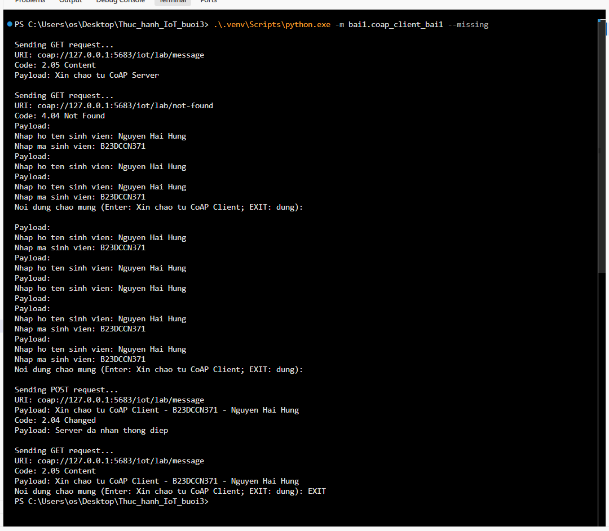
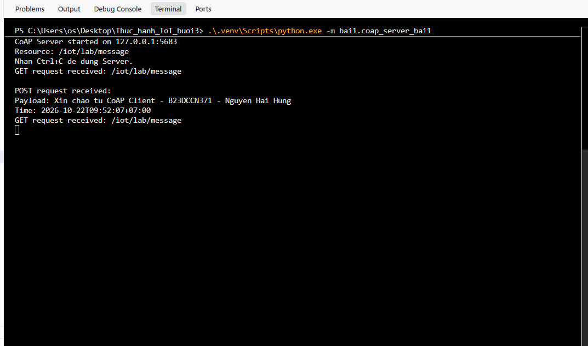
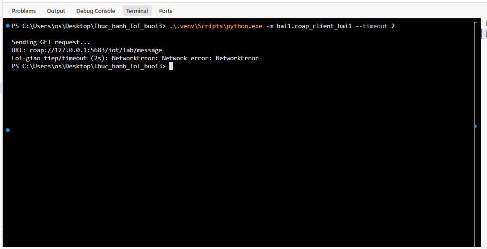
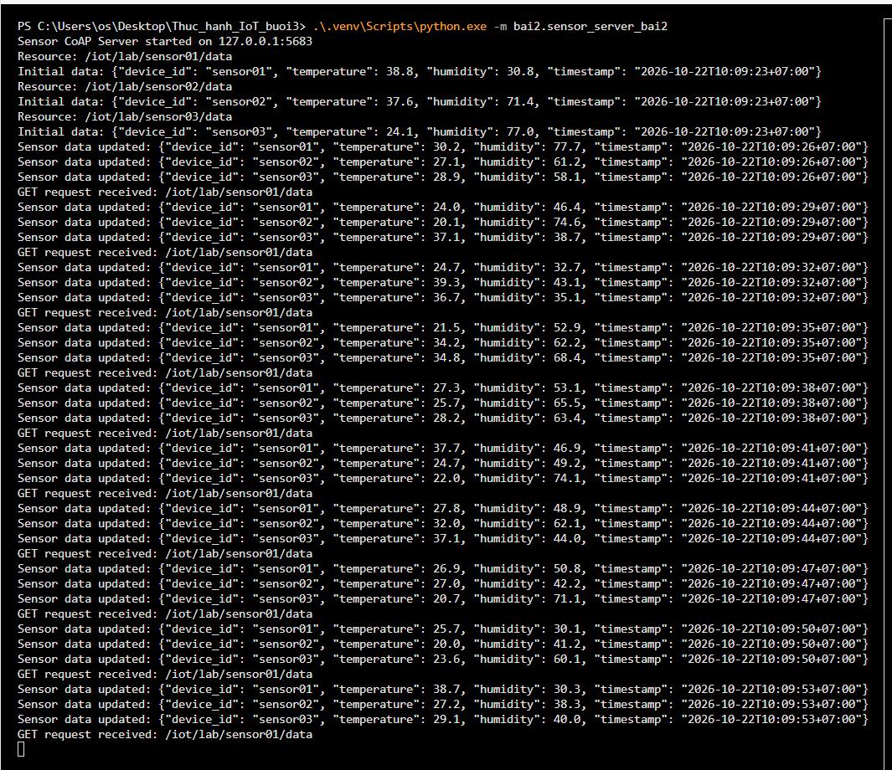
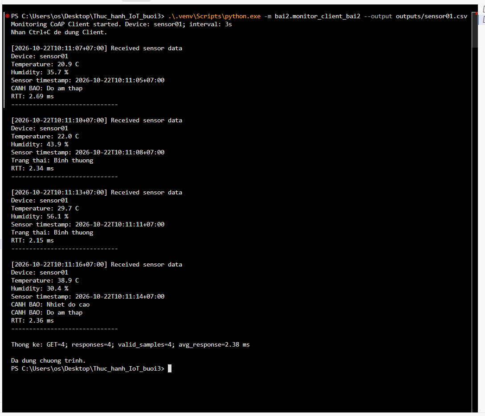
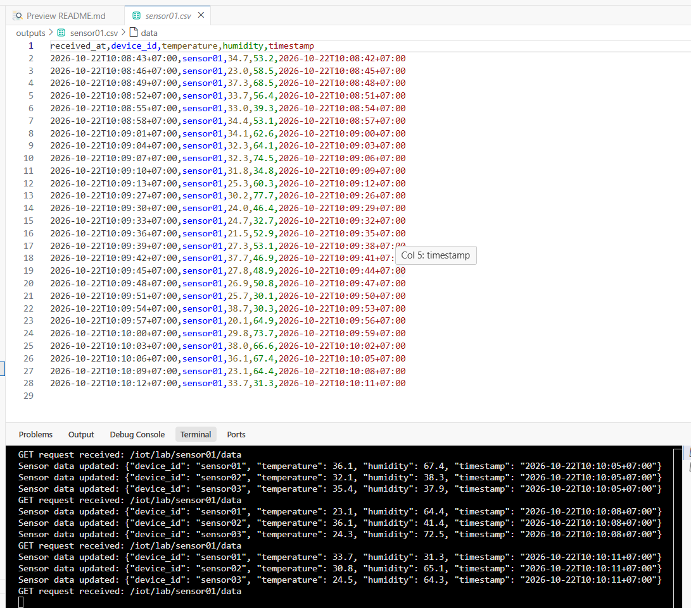
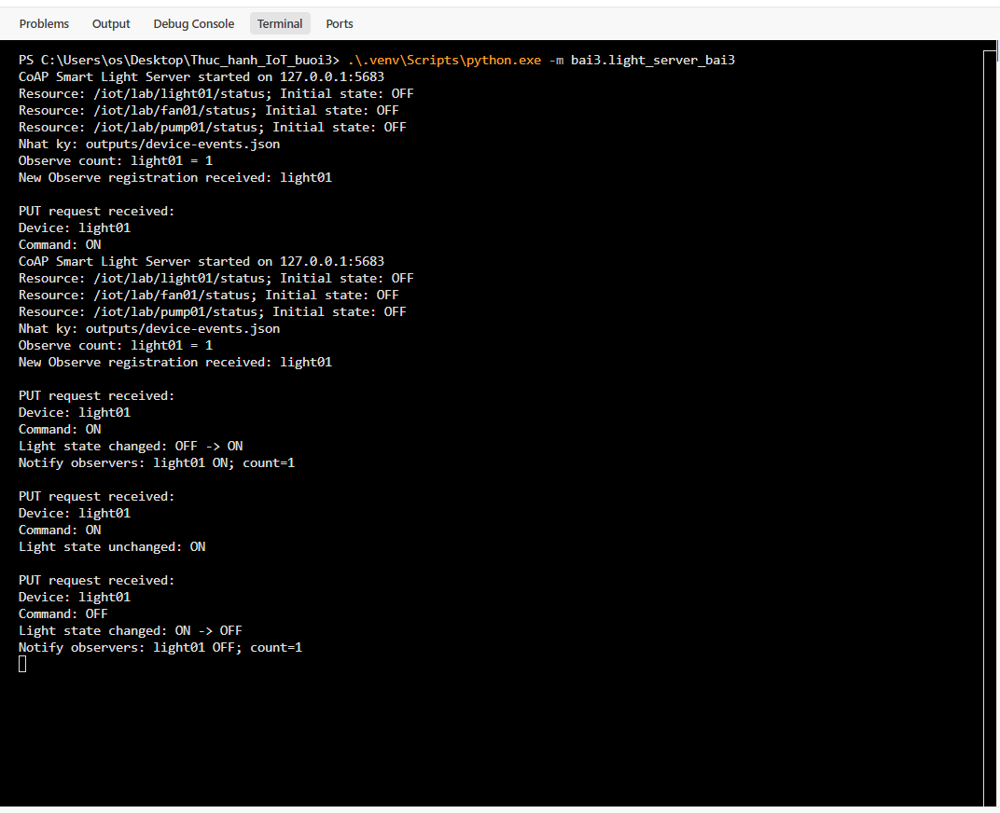
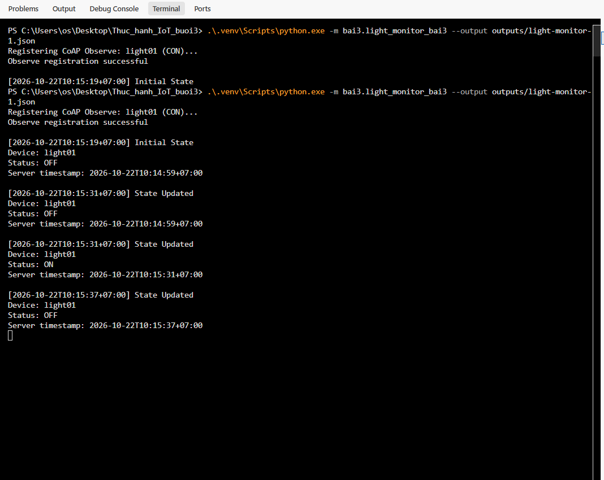
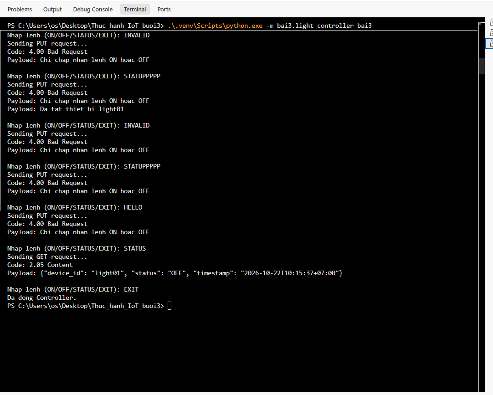

# THỰC HÀNH PYTHON VỚI GIAO THỨC CoAP

Bài thực hành gồm ba ứng dụng mô phỏng giao tiếp IoT bằng Python: gửi và nhận thông điệp với GET/POST, giám sát cảm biến bằng GET định kỳ, điều khiển và theo dõi trạng thái thiết bị bằng PUT và CoAP Observe.

## 1. Thông tin nhóm thực hiện

| Mã sinh viên | Họ và tên |
| --- | --- |
| B23DCCN371 | Nguyễn Hải Hưng |
| B23DCCN651 | Bùi Hồng Phú |
| B23DCCN060 | Vũ Viết Anh |

## 2. Môi trường sử dụng

| Thành phần | Phiên bản / cấu hình |
| --- | --- |
| Hệ điều hành | Windows |
| Python | 3.14.4 |
| Thư viện | aiocoap 0.4.17 |
| Giao thức | CoAP qua UDP |
| IP Server | `127.0.0.1` |
| Cổng | `5683` |

Server và Client chạy trên cùng máy tính, không cần MQTT Broker hoặc RabbitMQ. Thư viện được khai báo trong [requirements.txt](requirements.txt).

## 3. Cài đặt môi trường

Mở PowerShell tại thư mục gốc dự án:

```powershell
python -m venv .venv
.\.venv\Scripts\python.exe -m pip install -r requirements.txt
```

Kiểm tra phiên bản:

```powershell
.\.venv\Scripts\python.exe --version
.\.venv\Scripts\python.exe -m pip show aiocoap
```

Các lệnh trong báo cáo sử dụng trực tiếp Python của `.venv`, không cần kích hoạt môi trường. Chạy bằng `-m` từ thư mục gốc để các chương trình sử dụng được module chung `lab_common.py`.

## 4. Cấu trúc mã nguồn

```text
Thuc_hanh_IoT_buoi3/
├── bai1/
│   ├── coap_server_bai1.py
│   └── coap_client_bai1.py
├── bai2/
│   ├── sensor_server_bai2.py
│   └── monitor_client_bai2.py
├── bai3/
│   ├── light_server_bai3.py
│   ├── light_controller_bai3.py
│   └── light_monitor_bai3.py
├── evidence/
├── lab_common.py
├── requirements.txt
└── README.md
```

`lab_common.py` cung cấp các hàm dùng chung cho tham số dòng lệnh, thời gian, gửi request có timeout và ghi CSV/JSON. `evidence/` lưu ảnh minh chứng thực hành. Các file dữ liệu khi chạy được tạo trong `outputs/`.

## 5. Địa chỉ tài nguyên CoAP

| Bài | Thiết bị / tài nguyên | URI | Phương thức |
| --- | --- | --- | --- |
| 1 | Thông điệp | `coap://127.0.0.1:5683/iot/lab/message` | GET, POST |
| 2 | sensor01 | `coap://127.0.0.1:5683/iot/lab/sensor01/data` | GET |
| 2 | sensor02 | `coap://127.0.0.1:5683/iot/lab/sensor02/data` | GET |
| 2 | sensor03 | `coap://127.0.0.1:5683/iot/lab/sensor03/data` | GET |
| 3 | light01 | `coap://127.0.0.1:5683/iot/lab/light01/status` | GET, PUT, Observe |
| 3 | fan01 | `coap://127.0.0.1:5683/iot/lab/fan01/status` | GET, PUT, Observe |
| 3 | pump01 | `coap://127.0.0.1:5683/iot/lab/pump01/status` | GET, PUT, Observe |

Mỗi chương trình nhận `--host` và `--port` để thay đổi địa chỉ kết nối. Client có `--timeout` (mặc định 5 giây) và `--non` để gửi NON thay cho CON. Dùng `--help` để xem các tùy chọn của từng chương trình.

## 6. Cách chạy từng bài

Mỗi chương trình chạy trong một terminal riêng tại thư mục gốc dự án. Các bài dùng chung cổng `5683`, vì vậy dừng Server của bài trước bằng `Ctrl+C` trước khi chuyển sang bài tiếp theo.

### 6.1. Bài 1 — Gửi và nhận thông điệp

**Terminal 1 — CoAP Server:**

```powershell
.\.venv\Scripts\python.exe -m bai1.coap_server_bai1
```

**Terminal 2 — CoAP Client:**

```powershell
.\.venv\Scripts\python.exe -m bai1.coap_client_bai1 --missing
```

Client GET tài nguyên `/iot/lab/message` để nhận lời chào. Sau đó nhập họ tên, mã sinh viên và lời chào để gửi POST. Nhấn Enter ở lời chào để dùng nội dung mặc định:

```text
Xin chao tu CoAP Client - B23DCCN371 - Nguyen Hai Hung
```

Server in nội dung thông điệp cùng thời điểm nhận và trả xác nhận. Sau mỗi POST, Client GET lại để đọc thông điệp mới nhất. Tiếp tục nhập lời chào để gửi nhiều POST; nhập `EXIT` để kết thúc Client.

| Chức năng | Cách sử dụng |
| --- | --- |
| GET lời chào hoặc thông điệp cuối | Client gửi GET khi khởi động và sau mỗi POST |
| Nhiều POST liên tiếp | Nhập lời chào tiếp theo trong cùng phiên Client |
| Truy cập URI không tồn tại | Thêm `--missing`, Client gửi GET đến `/iot/lab/not-found` |
| Lỗi kết nối / timeout | Dừng Server, chạy Client với `--timeout 2` |

Lệnh thử khi Server không hoạt động:

```powershell
.\.venv\Scripts\python.exe -m bai1.coap_client_bai1 --timeout 2
```

### 6.2. Bài 2 — Giám sát cảm biến nhiệt độ và độ ẩm

**Terminal 1 — Sensor Server:**

```powershell
.\.venv\Scripts\python.exe -m bai2.sensor_server_bai2
```

Server mô phỏng ba cảm biến `sensor01`, `sensor02`, `sensor03`, cập nhật dữ liệu mỗi **3 giây**. Nhiệt độ ngẫu nhiên trong khoảng 20–40°C, độ ẩm trong khoảng 30–80%. Payload JSON có các trường `device_id`, `temperature`, `humidity`, `timestamp`, với Content-Format `application/json` (50).

**Terminal 2 — Monitoring Client:**

```powershell
.\.venv\Scripts\python.exe -m bai2.monitor_client_bai2 --output outputs/sensor01.csv
```

Client GET mỗi 3 giây, phân tích JSON và hiển thị mã thiết bị, nhiệt độ, độ ẩm, thời điểm nhận và thời gian phản hồi (RTT).

| Điều kiện | Thông báo |
| --- | --- |
| Nhiệt độ >35°C | `CANH BAO: Nhiet do cao` |
| Độ ẩm <40% | `CANH BAO: Do am thap` |
| Cả hai điều kiện đúng | Hiển thị cả hai cảnh báo |
| Không có điều kiện cảnh báo | `Trang thai: Binh thuong` |

Nhấn `Ctrl+C` để dừng theo dõi. Client in tổng số GET, số phản hồi, số mẫu hợp lệ và thời gian phản hồi trung bình. Trung bình được tính trên các phản hồi nhận được, không tính những request bị timeout.

**Chọn cảm biến, số lần GET và định dạng lưu dữ liệu:**

```powershell
.\.venv\Scripts\python.exe -m bai2.monitor_client_bai2 --device sensor02 --count 5 --output outputs/sensor02.json
.\.venv\Scripts\python.exe -m bai2.monitor_client_bai2 --device sensor03 --count 3 --output outputs/sensor03.csv
```

`--count 0` là chạy liên tục; số dương giới hạn số lần GET. CSV có header, JSON là danh sách các mẫu. Cả hai định dạng lưu thời điểm nhận và timestamp của cảm biến, nối thêm dữ liệu khi chạy lại với cùng file. Mỗi Client sử dụng một file output riêng.

Server nhận `--devices sensor01,sensor02,sensor03` để chọn danh sách cảm biến và `--seed 1` để tái hiện chuỗi số đo. Client chọn mã không tồn tại, chẳng hạn `--device sensor99`, sẽ nhận phản hồi `4.04 Not Found`. Nếu Server không phản hồi hoặc payload không hợp lệ, Client thông báo lỗi và tiếp tục chu kỳ giám sát.

### 6.3. Bài 3 — Giám sát và điều khiển thiết bị bằng Observe

**Terminal 1 — Smart Device Server:**

```powershell
.\.venv\Scripts\python.exe -m bai3.light_server_bai3
```

Server quản lý `light01`, `fan01`, `pump01`, trạng thái ban đầu là `OFF`. Tài nguyên hỗ trợ GET trạng thái, PUT điều khiển và Observe để thông báo thay đổi.

**Terminal 2 — Monitoring Client:**

```powershell
.\.venv\Scripts\python.exe -m bai3.light_monitor_bai3 --output outputs/light-monitor-1.json
```

Chờ `Observe registration successful` và trạng thái ban đầu trước khi điều khiển. Monitoring Client đăng ký bằng GET có Observe option, sau đó nhận notification từ Server, **không dùng GET polling định kỳ**.

**Terminal 3 — Controller Client:**

```powershell
.\.venv\Scripts\python.exe -m bai3.light_controller_bai3
```

| Lệnh | Chức năng |
| --- | --- |
| `ON` | PUT bật thiết bị |
| `OFF` | PUT tắt thiết bị |
| `STATUS` | GET trạng thái hiện tại |
| `EXIT` | Kết thúc Controller |

Nhập `STATUS`, `ON`, `STATUS`, `ON`, `OFF` để quan sát trạng thái và notification. PUT lặp lại trạng thái hiện tại được xác nhận nhưng không tạo thay đổi, notification hay dòng nhật ký mới. Nhập lệnh như `INVALID` để Server trả `4.00 Bad Request`; Controller vẫn tiếp tục nhận lệnh.

Payload PUT gồm `device_id` và `command`; payload GET/Observe gồm `device_id`, `status`, `timestamp`. Timestamp thể hiện thời điểm khởi tạo hoặc thay đổi trạng thái, còn thời điểm Monitor nhận được hiển thị riêng.

**Nhiều Monitoring Client:** mở thêm terminal và chạy:

```powershell
.\.venv\Scripts\python.exe -m bai3.light_monitor_bai3 --output outputs/light-monitor-2.json
```

Các Monitor cùng đăng ký tài nguyên nhận thông báo khi trạng thái thay đổi. Mỗi Monitor ghi vào file output riêng.

**Chọn thiết bị khác:**

```powershell
.\.venv\Scripts\python.exe -m bai3.light_monitor_bai3 --device fan01
.\.venv\Scripts\python.exe -m bai3.light_controller_bai3 --device fan01
```

Thay `fan01` bằng `pump01` để giám sát và điều khiển bơm. Mỗi thiết bị có trạng thái riêng; Server nhận `--devices light01,fan01,pump01` để khai báo danh sách.

**Nhật ký thay đổi trạng thái:** Server mặc định ghi `outputs/device-events.json`, gồm `timestamp`, `device_id`, `old_status`, `status`. Để lưu CSV:

```powershell
.\.venv\Scripts\python.exe -m bai3.light_server_bai3 --log outputs/device-events.csv
```

**CON và NON:** Client mặc định gửi Confirmable (CON). Thêm `--non` để gửi Non-confirmable (NON):

```powershell
.\.venv\Scripts\python.exe -m bai3.light_controller_bai3 --non
```

NON vẫn nhận phản hồi ứng dụng nhưng không sử dụng cơ chế xác nhận và truyền lại của CON. Nhập `EXIT` để đóng Controller; `Ctrl+C` để dừng Monitor và Server.

## 7. Kết quả thực hành và hình ảnh minh chứng

Các hình dưới đây ghi lại kết quả chạy trên máy tính ngày **22/10/2026**.

### 7.1. Bài 1 — Gửi và nhận thông điệp

Client nhận `2.05 Content` cùng lời chào từ Server, truy cập URI không tồn tại nhận `4.04 Not Found`, sau đó gửi POST có thông tin sinh viên và nhận `2.04 Changed`. GET tiếp theo trả lại thông điệp vừa gửi.



*Hình 1. CoAP Client gửi và nhận thông điệp, đồng thời hiển thị phản hồi 404 với URI không tồn tại.*

Server hiển thị payload POST và thời điểm nhận `2026-10-22T09:52:07+07:00`.



*Hình 2. CoAP Server xử lý GET và POST, in thông điệp chứa mã sinh viên và họ tên.*

Khi Server không hoạt động, Client báo lỗi giao tiếp và kết thúc phiên yêu cầu.



*Hình 3. Thông báo lỗi mạng khi chạy Client với tùy chọn `--timeout 2`.*

### 7.2. Bài 2 — Dữ liệu cảm biến, cảnh báo và lưu CSV

Server cung cấp ba tài nguyên cảm biến, in dữ liệu JSON và cập nhật theo chu kỳ 3 giây.



*Hình 4. Sensor Server mô phỏng sensor01, sensor02, sensor03 và tiếp nhận GET dữ liệu.*

Monitoring Client hiển thị số đo, trạng thái bình thường và các cảnh báo theo ngưỡng. Ở mẫu `38.9°C`, độ ẩm `30.4%`, cả hai cảnh báo xuất hiện. Cuối lượt chạy trong hình, Client thống kê 4 GET, 4 phản hồi, 4 mẫu hợp lệ, RTT trung bình `2.38 ms`.



*Hình 5. Giám sát định kỳ, cảnh báo nhiệt độ cao và độ ẩm thấp, thống kê khi dừng Client.*

File CSV lưu các cột `received_at`, `device_id`, `temperature`, `humidity`, `timestamp`, phục vụ xem lại và phân tích dữ liệu.



*Hình 6. Nội dung file sensor01.csv và dữ liệu được Sensor Server cung cấp.*

### 7.3. Bài 3 — Điều khiển và nhận thông báo Observe

Server tiếp nhận đăng ký Observe và lệnh PUT. Trạng thái đèn chuyển `OFF → ON → OFF`; PUT `ON` lặp lại khi đèn đang bật hiển thị `Light state unchanged: ON`.



*Hình 7. Server quản lý trạng thái thiết bị và gửi thông báo khi trạng thái thay đổi.*

Monitoring Client đăng ký Observe, hiển thị trạng thái ban đầu và các cập nhật ON/OFF cùng thời điểm nhận.



*Hình 8. Monitoring Client nhận trạng thái đèn qua Observe.*

Controller nhận `4.00 Bad Request` với các lệnh không hợp lệ. Lệnh `STATUS` tiếp theo vẫn trả `2.05 Content`, trạng thái `OFF`; `EXIT` đóng Client.



*Hình 9. Phản hồi lỗi với lệnh sai và truy vấn trạng thái bằng GET.*

## 8. Tài liệu tham khảo

- Tài liệu giảng viên: *Lập trình Python với giao thức CoAP — Thực hành buổi 3*.
- [aiocoap Documentation](https://aiocoap.readthedocs.io/).
